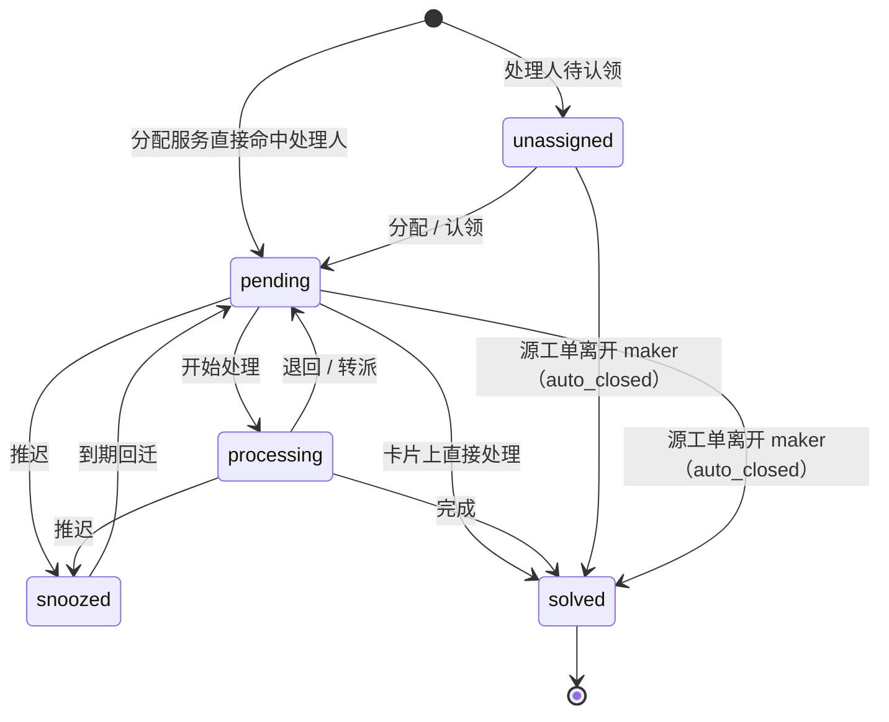
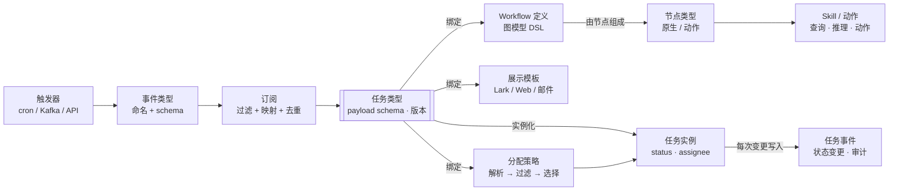
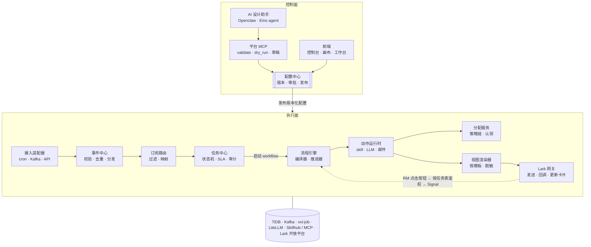

# AI 任务平台设计概要

Oct 15, 2026 · @rex

## 背景与目标

以 VIP 工单提醒和周期业务报表为首批场景，v1 直接按通用平台设计：**数据输入与处理流程解耦**，任何来源的数据先归一成事件，再按配置生成任务、分配处理人、驱动 workflow、通过 Lark 触达。

- **VIP 工单提醒**：交易命中规则产生工单 → 通知负责 RM；工单在 maker 状态超过 48h、7 天时再次提醒。
- **周期报表**：业务方通过 skill 生成报表，可设置为周期执行。
- **长期目标**：业务人员（RM、CS、运营）通过对话让 AI 生成定时任务和 workflow，人工审批后上线。

现有基建：Openclaw（对话入口）、LiteLLM（模型网关）、大数据 / 业务 DB / TiDB MCP、业务接口 MCP、Skillhub。

## 核心概念

平台由三类东西组成：**输入侧**（事件从哪来）、**任务侧**（要处理什么、谁处理、怎么展示）、**流程侧**（按什么步骤处理）。所有配置都版本化，发布后不可修改，只能发布新版本。

| 概念 | 定义 | 关键内容 |
| --- | --- | --- |
| 事件类型 Event Type | 一类输入数据的命名与结构，与来源无关 | 名称（如 `ticket.created`、`ticket.maker_overdue`）、payload schema、owner、数据敏感等级 |
| 触发器 Trigger | 产生事件的方式 | 类型：cron + skill 扫描 / Kafka topic / API 推送；调度表达式与时区；skill 及参数；字段映射；幂等键 |
| 订阅 Subscription | 把某类事件转成某类任务的规则 | 事件类型 + 过滤条件 → 任务类型；payload 映射；去重键（如 `ticket_id:48h`） |
| 任务类型 Task Type | 任务的抽象定义，平台的核心配置单元 | 名称 + 版本；payload JSON Schema（含 `x-pii`、`x-format` 等扩展）；默认优先级；SLA 策略；绑定的 workflow、展示模板、分配策略 |
| 任务实例 Task | 某个任务类型的一次具体任务 | 公共列（status、priority、assignee、sla\_status、resolution、escalation\_level、due\_at、dedup\_key、type\_version）+ JSON payload |
| 任务事件 Task Event | 任务的每一次变更记录 | 谁、何时、从哪个状态到哪个状态、原因；同时是审计数据和统计数据来源 |
| Workflow 定义 | 处理任务的流程，图模型 DSL | 节点 + 端口 + 连线；发布时编译成执行计划 Plan；运行实例锁定版本 |
| 节点类型 Node Type | Workflow 中可用的步骤种类 | 原生节点（condition、merge、timer、human\_choice）/ 动作节点（skill\_call、llm、lark\_card、send\_email、emit\_event）；配置 schema；输出端口 |
| Skill / 动作 Action | Activity 节点背后的可执行能力 | 分三类：查询（只读）、推理（LLM）、动作（有副作用）；输入输出 schema 契约 |
| 展示模板 View Template | 任务在各渠道的展示方式，与渠道无关 | header、fields、actions（按钮绑定状态机动作）、可选的 AI 摘要；渲染到 Lark 卡片 / Web 工作台 / 邮件 |
| 分配策略 Assignment Policy | 决定任务交给谁 | 候选人解析器 → 过滤器 → 选择策略 → 兜底；支持用户组、认领、管理员分配、轮询、按关系（RM-VIP） |

### 任务状态

主状态取值对齐 Morning Brief 的状态：原有 4 个取值和含义不变，只在最前面新增一个“待分配”状态，共 5 个；“>= 3 即终态”的判断保持成立。



> 取值：unassigned = -1，pending = 0，processing = 1，snoozed = 2，solved = 3（`>= 3` 即终态）。

| 值 | 常量 | 含义 |
| --- | --- | --- |
| -1 | `TaskStatusUnassigned`（新增） | 待分配：在组队列中等待认领，或等待分配服务确定处理人 |
| 0 | `TaskStatusPending` | 已分配并投递给处理人，等待处理 |
| 1 | `TaskStatusProcessing` | 已接手（点过「开始处理」或外链） |
| 2 | `TaskStatusSnoozed` | 主动推迟，到期由 cron 回迁 pending |
| 3 | `TaskStatusSolved` | 已完结；`>= 3` 即终态 |

分配服务直接命中处理人（如按 RM-VIP 关系）时，任务创建即为 `pending`，跳过 `unassigned`。RM 可以在 Lark 卡片上一步处理，从 `pending` 直接进入 `solved`。转派只改变 assignee，状态不变。源工单离开 Maker Review Case 状态时，系统把未完结的任务直接置为 `solved`。

新增状态取 `-1` 而不是 `4`：已有的 0 到 3 不用重新编号，Morning Brief 的存量数据和 `>= TaskStatusSolved` 的终态判断都不受影响。需要确认 Morning Brief 侧没有“status 非负”之类的假设。`waiting` 归入 `processing`；`cancelled` 合并进 `solved`，由结果码区分。

正交字段：`resolution`（contacted / dismissed / escalated\_out / auto\_closed）、`snooze_until`（`snoozed` 状态的回迁时间）、`sla_status`（on\_track / at\_risk / breached）、`escalation_level`（0 / 1 / 2）。所有状态变更走同一个服务方法：校验转移表、乐观锁、写 Task Event。

### 任务优先级

取值与 Morning Brief 的优先级保持一致，数值越小越紧急：

| 值 | 常量 | 含义 |
| --- | --- | --- |
| 0 | `TaskPriorityP0` | 立即 |
| 1 | `TaskPriorityP1` | 今日 |
| 2 | `TaskPriorityP2` | 机会 |
| 3 | `TaskPriorityP3` | 维护 |

- **由业务方定义**：任务类型配置默认优先级，也可以在订阅中按规则计算（如按交易金额或客户等级的表达式），平台只负责求值和存储。
- **平台提供调整接口**：`UpdatePriority(task_id, priority, reason)`，按权限控制谁可以调整，原因必填，写入 Task Event；调整后同步更新已发出的 Lark 卡片和任务列表排序。
- 优先级是独立字段，与状态互不影响；任务列表与 Morning Brief 先按优先级、再按截止时间排序。

## 概念之间的绑定关系

任务类型是平台的核心配置单元：事件经订阅转成任务类型，任务类型再绑定 workflow、展示模板和分配策略，四者一起发布、一起版本化。



分配策略决定任务实例的 assignee；workflow 由节点组成，动作节点最终调用 skill 或外部系统；任务实例的每次变更都写入任务事件。

一个任务类型的绑定配置示例：

```yaml
task_type: vip_ticket_alert
version: 2
schema_ref: vip_ticket_alert@2        # payload JSON Schema
workflow: vip_ticket_reminder@3        # 图模型 DSL
view: vip_ticket_card@2                # 展示模板
assignment:
  resolvers:
    - { type: relation, relation: vip_primary_rm }
    - { type: relation, relation: vip_backup_rm }
  filters: [active, not_on_leave, not_maker, within_capacity]
  strategy: least_load
  fallback: { group: vip_cs_leads, strategy: claim }
sla:
  - { after: 48h, action: remind }
  - { after: 7d,  action: escalate }
```

订阅侧示例：事件 `ticket.maker_overdue`（由每天 9:00 的 cron + `scan_maker_tickets` skill 产生）经过滤条件 `segment == 'vip'` 后，映射为 `vip_ticket_alert` 任务，去重键 `ticket_id:48h`。

### 节点级的展示模板与处理人分配

任务类型上的 `view` 和 `assignment` 只是默认值；workflow 中每个人工节点都可以覆盖，同一个任务在不同节点、推送给不同部门时，看到的卡片和处理人都可以不同。

```yaml
- id: rm_followup
  type: human_choice
  options: [contacted, escalate]
  # 不写 view / assignment：它是第一个人工节点，回退到任务类型默认（RM 跟进卡，按 RM-VIP 关系分配）

- id: compliance_review
  type: human_choice
  options: [approve, return]
  view:
    default: compliance_review_card@1
    variants:
      - { when: "viewer.dept == 'aml'", view: compliance_review_card_aml@1 }
  assignment:
    resolvers:
      - { type: agreement, agreement: cs_to_compliance@1 }   # 跨部门协议
    strategy: claim
    exclude: [task.maker, nodes.rm_followup.assignee]      # 职责分离
```

**展示模板的解析顺序**：节点上的受众变体 → 节点模板 → 上一个人工节点的模板 → 任务类型默认模板。

- **按节点**：不同环节展示不同字段，如 RM 跟进卡突出客户与联系方式，合规复核卡突出交易与规则命中明细。
- **按受众**：`variants` 按查看者的部门、角色选择模板；同一字段可按受众采用不同脱敏级别，跨部门人员只看到其环节所需的字段。
- **按钮来自节点**：卡片按钮由节点的 `options` 生成，模板只负责样式；编译期校验模板中的按钮与节点端口一一对应。

**人工节点的处理人分配**：

- **复用分配服务的策略链**（解析器 → 过滤器 → 选择 → 兜底），每个节点可以有自己的策略。
- **跨部门协议**：新增 `agreement` 解析器，引用配置中心中的跨部门协作协议（受理组、响应 SLA、升级联系人）。协议由对方部门维护和审批，我们的 workflow 只引用，不修改。
- **单人决策**：每个人工节点只由一个人做出决定；指派给用户组时，组内第一个认领的人成为处理人。需要多人参与时，拆成多个人工节点串联。
- **职责分离**：`exclude` 排除工单 maker、上游节点的处理人等，由平台强制执行。
- **当前处理人**：进入人工节点时，任务的 assignee 更新为该节点的处理人，并记录当前节点；Morning Brief 和 Lark 推送都发给当前处理人，任务表仍是唯一事实来源。

**未配置时的继承规则**：人工节点不写 `view` 或 `assignment` 时，沿用上一个人工节点的配置；路径上没有更早的人工节点时，回退到任务类型默认值。

- **编译期解析**：继承关系在发布时沿图计算并写入 Plan，运行时不再推断，每个节点最终用哪套模板和策略在发布前就能看到。
- **多个上游**：节点经 `merge` 汇合、不同路径上的“上一个人工节点”配置不一致时，编译报错，要求显式配置，避免运行时取决于走了哪条分支。
- **继承的是策略，不是人**：沿用上一节点的分配策略时会重新求值，结果通常是同一个人；需要固定为上一节点的实际处理人时，显式写 `assignment: { resolvers: [{ type: previous_assignee }] }`。
- **退回的环**：环内节点的继承同样在编译期确定，每一轮使用相同的模板和策略。

**AI 摘要（可选）**：配置 view 时可以开启 AI 对当前任务的总结摘要，摘要失败时卡片上不显示该区块。

```yaml
view:
  default: vip_ticket_card@2
  ai_summary:
    enabled: true
    prompt: vip_ticket_summary@1     # 提示词模板，版本化管理
    inputs: [rule_code, amount, maker_since, recent_txns]
    max_chars: 200
    timeout: 5s
```

- **先发后补，不阻塞触达**：卡片先发出，摘要通过 `llm` 动作异步生成，成功后更新原卡片。摘要永远不影响任务的推送和流转。
- **失败即隐藏**：输出为自然语言，格式与语气在提示词模板中约定；超时、模型报错、输出为空或超出 max\_chars 时，摘要区块整体不显示，卡片上不出现报错文案；失败只记入 Task Event 与指标。
- **按受众取数**：只把当前查看者可见的字段送给模型，并先按 `x-pii` 脱敏，避免跨部门推送时通过摘要泄露字段。
- **缓存**：按任务、节点与 payload 版本缓存，数据没有变化时不重复生成。
- **明确标识**：摘要区块标注“AI 生成，仅供参考”；workflow 的判断逻辑从不读取摘要内容。

## 功能模块

系统拆成 6 层 12 个模块。控制面（配置、AI 设计）只产出版本化配置；执行面（接入、任务、流程、触达）按配置运行，两者通过配置中心解耦。

| 层 | 模块 | 职责 | 关键实现 |
| --- | --- | --- | --- |
| 接入 | 1. 接入适配器 Ingestion | 把各种来源归一成标准事件信封 | Cron 调度执行 skill 扫描；Kafka 消费者；API / Webhook 网关；统一信封（type、subject、time、payload、dedup\_key） |
| 接入 | 2. 事件中心 Event Hub | 事件类型注册、校验、去重、分发 | 按事件类型 schema 校验；幂等键去重；写入内部 topic |
| 任务 | 3. 订阅路由 Subscription Router | 事件 → 任务创建请求 | 匹配订阅；过滤条件求值（expr）；payload 映射 |
| 任务 | 4. 任务中心 Task Service | 任务的唯一事实来源 | 状态机与转移表；乐观锁；Task Event 审计；SLA 计算；源工单状态变化时自动关闭任务 |
| 任务 | 5. 分配服务 Assignment Service | 决定处理人 | 策略链（解析器 → 过滤器 → 选择 → 兜底）；RM-VIP 关系；负载统计；认领 CAS；转派留痕；职责分离校验 |
| 流程 | 6. 流程引擎 Workflow Engine | 按 DSL 驱动任务前进 | 发布期编译器（校验、拓扑分析、生成 Plan）；轻量引擎的推进器（死路径消除、信号、受控的环、任务状态同步），详见《轻量工作流引擎设计》；节点执行器注册表 |
| 流程 | 7. 动作运行时 Action Runtime | 执行所有外部 IO | 引擎 Worker 池中的通用 `InvokeAction` 动作，分发到：skill 调用（MCP / Skillhub）、LLM（Eino → LiteLLM）、Lark、邮件、emit\_event |
| 触达 | 8. 视图渲染器 View Renderer | 模板 + 任务 → 各渠道内容 | 渠道无关视图 DSL；Lark 卡片 / Web / 邮件渲染器；按 `x-pii` 脱敏、按 `x-format` 格式化 |
| 触达 | 9. Lark 网关 Lark Gateway | 发送、回调、卡片更新 | 回调验签；open\_id → 内部用户；按任务表鉴权；调用引擎 Signal API；`task_id → message_id` 映射，状态变化时更新原卡片；降噪合并 |
| 控制面 | 10. 配置中心 Config Registry | 所有配置的版本与发布 | 事件类型、触发器、订阅、任务类型、workflow、模板、分配策略；草稿 → 审批 → 发布；dry-run 试运行 |
| 控制面 | 11. AI 设计助手 + 平台 MCP | 对话生成配置 | Openclaw / Eino agent 调用平台 MCP（list\_skills、get\_skill\_schema、list\_node\_types、validate、dry\_run、save\_draft）；校验 — 修复循环 |
| 横切 | 12. 公共库与可观测 | 各模块共用的能力 | JSON Schema 校验与 `x-` 扩展处理；expr 表达式；执行状态表 → 画布着色；指标（通知到联系时长、跟进率）；审计日志 |

前端包括三部分：配置控制台、workflow 画布（React Flow，设计态与运行态共用）、任务工作台（Uni-Workbench 内的任务列表与详情）。

## 内部架构与调用链路

控制面只产出并发布配置；执行面沿一条主链路把事件变成 RM 手上的 Lark 卡片，RM 的操作再沿虚线回到流程引擎。



主链路：接入适配器产生标准事件 → 事件中心校验去重 → 订阅路由生成任务 → 任务中心落库并启动 workflow → 流程引擎通过动作运行时调用分配服务、skill、LLM → 视图渲染器生成卡片 → Lark 网关发送。公共库与可观测模块横跨所有模块，图中未单独画出。

### Go 工程内部分包

仓库采用 go-zero 工程约定：HTTP 服务由 `goctl api` 从 `.api` 文件生成，数据访问层由 `goctl model` 从 `deploy/sql/*.sql` 生成；领域逻辑放在仓库根目录的 `internal/` 下，供各服务共用。

```text
app/
  api/                 # HTTP / Lark 回调 / 平台 MCP 入口（goctl api 生成 handler/logic/svc/types）
    workbench.api
  worker/              # 引擎 Worker 池、推进器、xxl-job ticker 处理器
deploy/sql/            # 表结构，goctl model 的输入
internal/
  model/               # goctl model 生成的 *_gen.go 与可扩展的 *model.go
  ingest/              # 接入适配器、事件信封
  event/               # 事件类型注册、校验、去重
  subscription/        # 订阅匹配与映射
  task/                # 任务状态、优先级、转移表、Task Event、SLA
  assign/              # 分配策略链、认领、转派
  flow/
    dsl/               # 图模型定义
    compiler/          # 校验、拓扑分析、编译期继承、生成 Plan
    engine/            # 推进器、认领与租约、边传播、区域重置、状态同步
    nodes/             # 节点执行器注册表
  action/              # InvokeAction 分发：skill、llm、lark、email、emit_event
  view/                # 视图模板、受众变体、AI 摘要、渲染器
  lark/                # 发送、回调验签、身份映射、卡片更新
  ticker/              # xxl-job 调度入口
  registry/            # 配置版本、审批、发布、dry-run
  mcp/                 # 平台 MCP 工具
  pkg/
    schema/            # JSON Schema 校验、x- 扩展（脱敏、格式化）
    expr/              # 表达式编译与求值
    obs/               # 指标、审计、链路
```

依赖方向保持单向：`flow` 不直接依赖 `task`、`assign`、`lark`，只通过 `action` 的动作执行器调用它们，这样引擎核心不会因业务模块变化而改动。

## 关键设计原则

1. **AI 用在设计时，执行保持确定性。** 是否超时、通知谁由 SQL 和规则决定；AI 生成的是配置，必须通过与人工配置相同的校验器，只能保存为草稿。
2. **配置版本化、不可变。** 任务实例绑定 `type_version`，workflow 实例锁定 DSL 版本；修改即发布新版本。
3. **Schema 驱动。** 新增任务类型只需注册 schema、模板和策略，Go 代码不改动；平台层透传 `json.RawMessage`，少数类型用泛型 `Decode[T]` 获得强类型。
4. **金额不经过 float64。** schema 中金额用 string，解码开启 `UseNumber()`，业务侧用 decimal。
5. **引擎核心保持薄而稳定。** 变化放进动作与节点类型：新增动作只在 `InvokeAction` 注册实现，推进器代码不变。
6. **推进过程可复现。** 遍历编译期排好序的切片而非 map；外部 IO 在事务外执行，图的推进只在锁 run 行的事务内完成。
7. **任务表是处理人的唯一事实来源。** API 层按任务表鉴权，引擎的 Signal 只校验节点是否等待、选项是否合法。
8. **DSL 严格受限。** 只支持有限的节点类型，只允许受控的环（rework 边），不支持脚本；复杂关键流程直接用 Go 写成系统节点。
9. **控制状态大小。** 大输出存对象存储，状态表只保存引用；事件日志按月分区归档。
10. **自动化本身也要 maker-checker。** 配置发布需审批；dry-run 是必经步骤；AI 能用的 skill 与数据范围不超过当前用户权限。
11. **出口统一脱敏。** 按 `x-pii` 在发往 Lark、LLM、日志时处理；工单 maker 不能被分配为 checker。
12. **回执闭环。** 每次触达都要能收到 RM 的反馈，回写任务并产生指标。

## v1 范围与演进

v1 用通用抽象跑通 VIP 工单提醒和周期报表两个场景；DSL 稳定之前不做画布。

1. **v1 通用内核**：全部 12 个模块的最小实现；DSL 用手写 yaml；节点类型限定为 trigger、condition、merge、timer、human\_choice、skill\_call、llm、lark\_card、send\_email、emit\_event、end；并发与故障注入测试覆盖分支、汇合、跳过传播、超时和点击与超时竞争。
2. **v2 AI 辅助配置**：基于模板（工单超时提醒、周期报表等 recipe）由 AI 生成定时任务和 workflow；dry-run 与审批流上线；建立 30 到 50 条真实需求的评估集。
3. **v3 可视化与扩展**：workflow 画布（设计态 + 运行态）；循环节点、子流程节点；运行时 LLM 增强步骤（如 RM 沟通建议）。

### 已确认

- **RM-VIP 关系**：通过 API 获取，一个 RM 对应多个 VIP 或一组 VIP。分配服务的关系解析器调用该 API 并带缓存；任务创建时快照 assignee；RM 交接时批量转派未完成任务。
- **源工单状态感知**：事件推送与定时扫描都需要。工单创建走事件推送；Maker Review Case 超过 48h、7 天这类持续条件走定时扫描；两条路径共用幂等键，不会重复建任务。
- **Skill schema**：Skillhub 中的 skill 已有机器可读的输入输出 schema，可以直接支撑 AI 生成定时任务和 workflow。
- **工作流引擎**：不使用 Temporal，自研轻量引擎，只依赖 TiDB 与 xxl-job，详见《轻量工作流引擎设计》。引擎是流程的事实来源，任务状态是其投影，经 `sync_task` job 异步同步、最终一致。每个人工节点只由一个人决策，多人参与时拆成多个节点串联。
- **任务来源**：任务类型配置时需指定一个或多个来源（事件推送、cron 扫描、API），多个来源共用幂等键。cron 来源可由 AI 结合 skill、大数据 MCP、业务 DB MCP 生成；优先使用已认证的查询 skill，AI 编写的查询经审核后沉淀为新的 skill。
