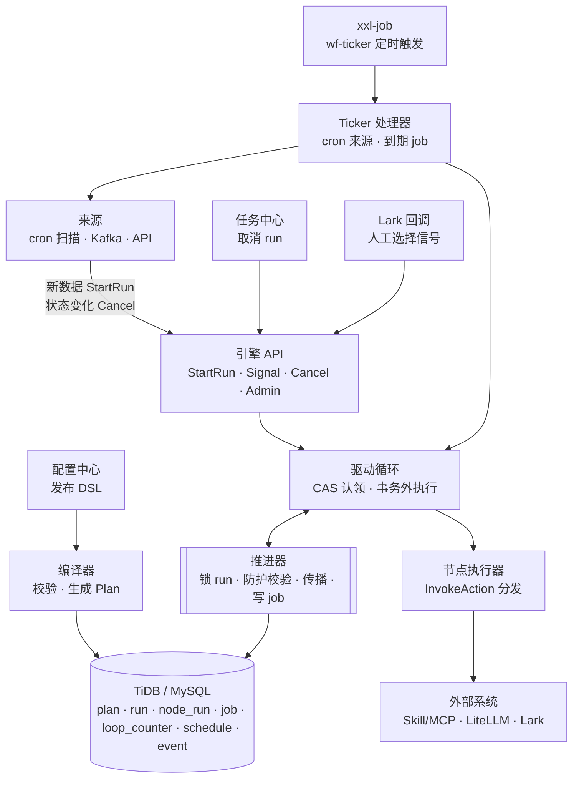

# 轻量工作流引擎设计

Oct 16, 2026 · @rex

## 目标与边界

自研一个 **DSL 解释型、状态显式持久化** 的轻量工作流引擎，只依赖 TiDB 或 MySQL 8.0（均为 MySQL 协议）和已有的 xxl-job，替代 Temporal。核心判断：我们的 workflow 是图数据而不是代码，运行状态可以直接存表，因此不需要 Temporal 的确定性回放体系。

**要做的能力**

- 图模型 DSL 的编译与执行：分支、并行、汇合、死路径消除。
- 持久化执行：进程崩溃、发版重启后从数据库恢复，不丢步骤。
- 步骤重试、超时、失败后人工干预。
- 持久化定时器：从几十秒到数周的等待。
- 外部信号：人工选择、外部系统回调，带鉴权与校验。
- 受控的环：人工退回上游节点，有次数上限。
- 运行状态可查询，支撑画布着色与审计。

**不做的能力**

- 用代码编写任意 workflow（只执行 DSL）。
- 确定性回放、事件溯源式的执行历史。
- 跨机房多活、毫秒级调度延迟。
- 子流程、动态 fork（后续按需在 v2 之后加入）。

**规模假设**：内部业务流程，量级远低于通用编排平台，步骤调度延迟秒级可接受，定时器精度几十秒可接受。

## 参考项目与借鉴点

不照搬任何一个项目：**执行模型参考 Conductor，调度与租约参考 Camunda 和 River，汇合语义参考 Airflow，交互语义参考 Temporal 和 Dify**。

| 项目 | 借鉴 | 不借鉴 |
| --- | --- | --- |
| [Conductor](https://docs.conductor-oss.org/devguide/how-tos/Tasks/choosing-tasks) | 最接近的参照物：JSON 定义的 workflow，状态存库；系统任务分类（SWITCH、FORK\_JOIN/JOIN、DO\_WHILE、WAIT、HUMAN）；WAIT 等时间、HUMAN 等外部信号的区分；每次执行保存不可变的定义快照；AI 生成的定义与人工设计的定义跑在同一个运行时；循环必须有上限 | Java 服务端与额外存储依赖；worker 通过 HTTP 轮询服务端 |
| [Camunda 7 Job Executor](https://camunda.com/blog/2015/09/scaling-camunda-bpm-in-cluster-job/) | 用锁拥有者 + 锁过期时间认领 job，乐观锁防止并发认领；认领冲突时指数退避；它踩过的坑：执行超过锁时长的 job 会被重复认领，需要防护校验 | BPMN 的完整规范与复杂度 |
| [River](https://riverqueue.com/) | 事务内入队：业务写入与 job 插入同一事务提交；唯一 job；job 完成与业务变更同事务提交 | `SKIP LOCKED` 认领（TiDB 不支持该语法） |
| [DBOS Transact](https://docs.dbos.dev/golang/integrating-dbos) | 每完成一步就把输出检查点写入数据库，崩溃后从最后完成的一步恢复；持久化 sleep | 以代码定义 workflow 的模型 |
| [go-workflows](https://github.com/cschleiden/go-workflows) | Go 风格的执行器接口设计；它缺少 workflow 版本管理，印证了“运行实例锁定定义版本”的必要性 | 基于历史回放的执行模型 |
| [Airflow 触发规则](https://www.astronomer.io/docs/learn/airflow-trigger-rules) | 汇合语义：分支之后的节点用 `none_failed` 或 `one_success` 而非 `all_success`；skipped 状态向下游传播 | 调度器轮询数据库推进 DAG 的整体架构 |
| Temporal | 重试策略字段（初始间隔、退避系数、最大间隔、最大次数）；Update 先校验后接受的信号语义；workflow ID 唯一性 | 确定性回放、事件历史、workflow 代码版本管理 |
| Dify | 画布模型：节点 + 端口 + 连线；Human Input 节点的按钮即端口、超时即分支 | 以 LLM 应用为中心的节点体系 |

## 总体架构

引擎以库的形式运行在业务 Go 进程内，只依赖 TiDB 或 MySQL 和 xxl-job；**推进器是唯一修改节点状态的组件**，其他组件都通过它推进图。



引擎没有常驻的工作池，也不轮询数据库，**只在事件到来时推进**。引擎 API 收到事件后经推进器落库，再由驱动循环在同一个调用里认领新就绪的 job、事务外执行节点、交给推进器提交，如此反复，直到流程停在等待点（人工、定时器、重试退避）或结束。xxl-job 的 tick 是唯一的时钟，唤醒到期的定时器、超时和重试。

| 组件 | 职责 |
| --- | --- |
| 编译器 | 发布时校验 DSL，生成不可变的 Plan |
| 引擎 API | `StartRun`（按 `biz_key` 幂等）、`Signal`、`Cancel`、管理操作 |
| 推进器 | 锁 run 行；防护校验；写节点结果；边传播与死路径消除；插入新 job；环的区域重置 |
| 驱动循环 | 事件处理完后就地认领并执行新就绪的 job，直到流程停在等待点或结束 |
| 节点执行器 | 原生节点本地处理；动作节点统一经 `InvokeAction` 分发到 skill、LLM、Lark、邮件 |
| Ticker 处理器 | 响应 xxl-job：触发到期的 cron 来源；执行到期的定时器、超时、重试与租约过期的 job；巡检告警 |

## 数据模型

8 张表，全部在同一个库（TiDB 或 MySQL）。定时器不单独建表，统一作为带 `due_at` 的 job；边状态不单独存储，由节点状态和端口推导。

```sql
-- 编译后的执行计划，发布后不可变
wf_plan (
  plan_id, version, dsl JSON, compiled JSON, checksum, published_at,
  PRIMARY KEY (plan_id, version)
)

-- 运行实例
wf_run (
  id BIGINT AUTO_RANDOM PRIMARY KEY,
  plan_id, plan_version,            -- 启动时锁定，之后不变
  biz_key UNIQUE,                   -- 业务幂等键，如 task_id，防止重复启动
  status,                           -- running / succeeded / failed / needs_intervention / cancelled
  vars JSON, version INT,           -- version 用于乐观并发与审计
  created_at, updated_at
)

-- 节点的当前状态，每个节点一行
wf_node_run (
  run_id, node_id,
  iteration INT DEFAULT 0,          -- v1 恒为 0，为受控的环预留
  status,                           -- pending / ready / running / waiting / succeeded / skipped / failed
  port,                             -- 节点完成时选中的输出端口
  output JSON,                      -- 大输出只存引用
  attempt INT, wait_until, started_at, finished_at,
  PRIMARY KEY (run_id, node_id)
)

-- 环重置时归档旧轮次，用于审计与画布回放
wf_node_run_history ( run_id, node_id, iteration, status, port, output, ... )

-- 统一的任务表：立即执行、超时、唤醒、定时器都是 job。
-- 立即执行的 job 在产生它的调用里就被执行；留在表里等 tick 的只有将来的工作和需要恢复的工作
wf_job (
  id BIGINT AUTO_RANDOM PRIMARY KEY,
  run_id, node_id, iteration,
  kind,                             -- execute / timeout / wake / timer / sync_task / effect
  due_at, status,                   -- pending / done / cancelled / failed（隔离的毒丸 job）
  attempt, owner, locked_until,     -- 租约；(owner, attempt) 是一次认领的凭证
  fail_count,                       -- 处理失败次数（加载或提交出错），超限后隔离
  idem_key UNIQUE,                  -- run_id:node_id:iteration:kind
  INDEX (status, due_at)
)

-- 退回边的计数
wf_loop_counter ( run_id, edge_id, count, PRIMARY KEY (run_id, edge_id) )

-- cron 来源，由 ticker 计算并推进 next_fire_at
wf_schedule ( id, cron, timezone, target, next_fire_at, enabled, version )

-- 追加写的事件日志：状态变更、信号、操作人
wf_event ( id, run_id, node_id, iteration, type, payload JSON, actor, created_at )
```

设计要点：

- **`wf_run.biz_key` 唯一**：同一个任务不会因为事件重复投递而启动两个 run。
- **主键与热点**：实际表结构见 `deploy/sql/engine.sql`。为适配 goctl（单列主键、Insert 省略自增列），联合主键改为 `id` 主键 + 联合唯一键，主键用 `AUTO_INCREMENT`，TiDB 上配合 `NONCLUSTERED` 主键与 `SHARD_ROW_ID_BITS` 打散写入；规模上来后再评估改为 `AUTO_RANDOM` 并由应用生成 ID。
- **TiDB 与 MySQL 的差异**：设计只用两者共有的能力（主键 `SELECT ... FOR UPDATE`、CAS 更新、JSON 列），MySQL 需 8.0 及以上。需要注意三点：TiDB 多节点下自增 `id` 不保证单调，排序和去重一律用 `seq` 或业务唯一键；TiDB 有单事务大小上限，推进事务只写一个 run 的少量行，不受影响；TiDB 专用选项写在 `/*T! */` 注释中，MySQL 会忽略，同一份 DDL 两边都能执行。
- **`wf_plan` 的版本从属于任务类型**：`plan_id` 为任务类型 key，`version` 即任务类型的发布版本，由发布清单引用；workflow 不单独对用户暴露版本号（见《AI 任务平台设计概要》「版本管理」）。
- **`wf_event` 只追加、不更新**：审计、画布回放、指标统计都从这里读，与执行状态表解耦。

## DSL 与编译器

DSL 是“节点 + 端口 + 连线”的图；编译器在发布时完成全部结构校验，产出不可变的执行计划，运行时不再做结构判断。

### 节点类型

| 节点 | 类别 | 输出端口 | 说明 |
| --- | --- | --- | --- |
| `trigger` | 原生 | `next` | 入口，接收触发数据 |
| `condition` | 原生 | 每个分支一个端口 + `default` | 表达式求值，选中一个端口 |
| `merge` | 原生 | `next` | 汇合，模式 `all` / `any` |
| `timer` | 原生 | `next` | 等待固定时长或到某个时间点 |
| `human_choice` | 原生 | 每个选项一个端口；配置超时时另有 `timeout` | 发卡片并等待人工选择，可配置重复提醒 |
| `skill_call` / `llm` / `lark_card` / `send_email` / `emit_event` | 动作 | `next`、`error` | 统一经 `InvokeAction` 执行外部 IO |
| `end` | 原生 | 无 | 结束 |

所有节点都可以挂 `side_effects`（旁路动作），以 `async` 方式执行，不阻塞主路径。

### 汇合语义

借鉴 Airflow 的触发规则，`merge` 只提供两种模式：

- `all`：所有入边都有结论，且至少一条触发（相当于 `none_failed_min_one_success`）。用于并行分支汇合，以及条件分支之后的汇合。
- `any`：任一入边触发即执行，之后到达的忽略（相当于 `one_success`）。

普通节点有多条入边时默认按 `all` 处理。

### 编译期校验

1. **结构**：去掉 `rework` 边后拓扑排序必须成功；所有节点从 `trigger` 可达；除 `end` 外每个节点都有出边。
2. **端口**：每条边的源端口必须是该节点类型声明的端口；`human_choice` 配置了超时则 `timeout` 端口必须有连线，未配置则不允许连线。
3. **配置**：每个节点的配置按其类型的 JSON Schema 校验；引用的 skill、模板、任务类型必须存在且已发布。
4. **变量引用**：表达式只能使用 `payload`、`task`、`nodes.<id>.output`、`loop`（仅环内）这几个命名空间；`nodes.X` 中的 X 必须位于当前节点的上游且有路径可达；表达式在编译期预编译，语法错误或读取当前时间直接报出。
5. **受控的环**：见“受控的环”一节。

### 执行计划（Plan）

编译产物包括：按拓扑序排好的节点列表、每个节点的入边与出边（切片，顺序固定）、每条 `rework` 边对应的环区域节点集合、预编译的表达式。运行时只读 Plan，不再遍历原始 DSL。

## 执行模型

执行分为两段：**事务外执行节点（外部 IO），事务内推进图**。同一个 run 的所有推进通过锁 `wf_run` 行串行化，这是正确性的核心。

### 事件驱动

流程由外部状态推动，引擎只响应四种事件：

| 事件 | 引擎入口 | 来自 |
| --- | --- | --- |
| 新数据 | `StartRun`（按 `biz_key` 幂等） | cron 扫描、Kafka、API 推送 |
| 人工操作 | `Signal` | Lark 卡片回调、前端 |
| 外部状态变化 | `Cancel` | 来源的 `close_when`、任务中心 |
| 时间到期 | `ProcessDue` | xxl-job `wf-ticker` |

每个事件提交后，驱动循环在同一个调用里继续执行新就绪的节点（就地推进），直到流程停在等待点或结束。`wf_job` 因此只保存“现在不能做”的工作：定时器、超时、退避后的重试，以及进程在执行中崩溃后留下的租约过期的 job，它们都由 tick 执行。没有事件、也没有到期的 job 时，引擎不产生任何查询。

早期版本用常驻 Worker 池每秒轮询 `wf_job`：空闲时也持续扫表，多个进程的轮询与范围更新在 MySQL 可重复读下互相持有间隙锁，并发测试中出现过死锁。流程本身就是由外部状态推动的，轮询既不必要，也引入了额外的并发面，因此改为事件驱动。

取舍：

- **定时精度等于 tick 周期**（10 到 30 秒）。对小时、天级的提醒足够；需要秒级精度的场景不适合这个引擎。
- **就地推进有边界**。一次推进最多执行 100 个 job，同时最多 4 个（并行就绪的分支并发执行，不互相排队）；超出的 job 留在表里由 tick 接着执行。
- **入口不必等推进完成**：
  - cron 来源启动 run 时只提交、不就地推进（`Defer`），一次扫描启动的大量 run 由同一次 tick 随后的“执行到期 job”并行执行；
  - Lark 回调要求 3 秒内响应，`CallbackService` 用异步信号（`Async`）：信号提交后立即返回，后续推进在后台进行。后台推进脱离请求的 ctx，同时最多 64 个，满了就留给 tick；进程退出时 `Close` 等待它们结束，超时则取消并立即释放已认领的 job。

### 一次节点执行的完整流程

1. **认领**：驱动循环用 CAS 抢占 job，参考 Camunda 的锁拥有者 + 锁过期时间做法。TiDB 不支持 `SKIP LOCKED`，CAS 方式在 TiDB 上可直接使用。MySQL 8.0 虽然支持 SKIP LOCKED，也统一用 CAS，两种库的行为保持一致。认领成功后重新读取 job 的 `attempt`：`(owner, attempt)` 就是这次认领的凭证，之后对 job 的每一次修改都必须带上它（见“认领凭证”）。
2. **开始**：开启事务，锁 run 行，再锁 job 行确认仍由这次认领持有；把节点置为 `running`、记下 `attempt`，并把租约延长到节点超时之后。
3. **执行**：事务外调用节点执行器（skill、LLM、发卡片等），不持有任何数据库锁，超过节点超时即取消。
4. **提交**：开启悲观事务，锁 run 行，确认认领仍然有效，做防护校验，写结果，传播，插入新 job，全部一次提交。
5. **继续**：提交返回本次插入的 job。已到期的（新就绪节点、`sync_task`、`effect`）在同一个调用里回到第 1 步立即执行，并行就绪的并发执行；未到期的（定时器、超时、重试）和超出预算的留在表里，等 tick 唤醒。

```sql
-- 1. 认领（影响行数为 0 = 被别人抢走）
UPDATE wf_job
SET owner = ?, locked_until = NOW() + INTERVAL ? SECOND, attempt = attempt + 1
WHERE id = ? AND status = 'pending' AND due_at <= NOW()
  AND (owner = '' OR locked_until < NOW());

-- 之后对 job 的任何修改（开始、完成、释放、重试、隔离）都带上凭证
... WHERE id = ? AND owner = ? AND attempt = ? AND status = 'pending';
```

```go
// 4. 提交（伪代码）
tx := db.BeginPessimistic()
run := tx.SelectForUpdate("wf_run", runID)          // 串行化同一 run 的推进；先锁 run，再锁 job
if !tx.LockHeld("wf_job", job.ID, job.Owner, job.Attempt) {
    tx.Rollback()                                      // 认领已失效：job 属于更新的认领，只丢弃结果，不动 job
    return
}
node := tx.Get("wf_node_run", runID, nodeID)

// 防护校验：节点仍在执行、轮次和尝试次数与认领时一致
if node.Status != Running || node.Iteration != job.Iteration || node.Attempt != job.Attempt {
    tx.FinishJob(job, "cancelled")                     // run 已取消或节点已被退回，结果丢弃
    tx.Commit()
    return
}

tx.CompleteNode(node, result.Port, result.Output)
ready := propagate(tx, plan, run, nodeID, result.Port) // 死路径消除，返回新就绪节点
for _, n := range ready {
    tx.InsertJob(run.ID, n, "execute", now)            // idem_key 唯一，重复插入直接失败
}
if noRunningOrWaiting(tx, run) {
    tx.FinishRun(run)
}
tx.AppendEvents(...)
tx.Commit()
```

### 边传播与死路径消除

边的状态由源节点推导：源节点 `succeeded` 且端口匹配为触发，源节点 `skipped` 或走了其他端口为跳过。传播逻辑：

- 对目标节点检查入边：全部有结论且至少一条触发 → 就绪；全部跳过 → 标记 `skipped` 并继续向下传播；还有未决入边 → 等待。
- 从 `pending` 到 `ready` 的迁移带条件更新（`WHERE status = 'pending'`），保证每个节点在一轮中只被调度一次。
- 遍历 Plan 中预先排好序的切片，不遍历 map，结果稳定、可复现。

### 为什么需要防护校验

Camunda 记录过一个典型问题：执行时间超过锁时长的 job 会被另一个执行器重新认领，前一个执行器完成后再写回，就会产生冲突甚至并行执行。我们用 `attempt` 和 `iteration` 做围栏：重新认领时 `attempt` 加 1，原执行者提交时发现不一致，结果直接丢弃。外部副作用依靠幂等键兜底（见“失败处理、幂等与恢复”）。

### 认领凭证

围栏只靠节点上的 `attempt` 不够，job 本身也必须按凭证 `(owner, attempt)` 修改。只比较 `owner` 时有两种交错会让流程永久卡住：

| 交错 | 只比较 owner 时的结果 | 按凭证处理 |
| --- | --- | --- |
| 同一进程的 tick 重新认领了自己过期的 job，旧执行先返回 | 旧执行按 owner 把 job 取消，新执行提交时找不到 job，节点停在 `running` | 旧执行发现 job 已不归自己，只丢弃结果 |
| A 认领后、开始执行前停顿超过租约，B 重新认领并开始执行 | A 恢复后把节点的 `attempt` 写回旧值并执行，B 提交时被判为过期并取消 job | A 在开始执行的事务里发现认领已失效，不执行、不改节点 |

规则：失去资格的一方只能放弃自己的结果，不能修改 job 或节点；只有持有当前凭证的一方能完成、释放或隔离 job。开始执行和提交都在锁 run 行之后锁 job 行确认凭证，加锁顺序固定为“先 run 后 job”。

### 超时与租约

单次执行超时、租约和整体重试是三件事：超时取消一次调用；租约防止执行期间被别人重复认领；重试决定失败后还执行几次。

- **超时**：`skill_call`、`llm` 可配置 `timeout`；默认 skill 等动作 30 秒、LLM 2 分钟，上限 10 分钟。超时的调用被取消，按错误码 `timeout` 失败，再由重试策略决定是否重试。
- **租约**：开始执行时把租约延长到“超时 + 30 秒”，执行期间不会被重新认领；进程崩溃时，租约到期后由 tick 接手。

## 人工节点、定时器与 xxl-job 时钟

所有“等待”都落成带 `due_at` 的 job；xxl-job 只负责按时唤醒，状态与逻辑全部在引擎内。

### human\_choice 节点

```yaml
- id: ask_rm
  type: human_choice
  assignment: vip_rm_policy@1        # 可省略：继承上一个人工节点（见“人工节点的处理人与展示”）
  view: vip_ticket_card
  options: [contacted, snooze, dismiss]
  form: { dismiss: [reason] }        # 某些选项要求必填
  timeout: 48h                        # 可选；也可以是表达式；不配置则一直等待
  remind: { every: 24h, max: 3 }      # 可选；等待期间重复提醒
```

| 事件 | 引擎动作（均在锁 run 行的事务内） |
| --- | --- |
| 节点执行 | 确定处理人、渲染卡片；节点置为 `waiting`，同事务插入发卡片的 `effect` job，配置了超时则插入 `timeout` job（从进入等待算起），配置了提醒则插入 `wake` job；提交后发送卡片 |
| RM 点击 | API 先按任务表鉴权；事务内确认节点仍 `waiting`、轮次一致、选项合法、必填项齐全；写端口；作废该节点的 timeout / wake job；传播 |
| 选择 snooze | 节点保持 `waiting`，作废原 wake job，按 snooze 时长插入新的 wake job，并同步任务状态为 snoozed |
| wake 到期 | 重新发卡片（幂等键带提醒序号），按配置插入下一次 wake；若来自推迟，同步任务回迁 pending |
| timeout 到期 | 若节点仍 `waiting`，按 `timeout` 端口完成并传播 |

点击与超时在同一行锁下竞争，只有先到的生效。信号语义参考 Temporal 的 Update：先校验，不通过直接拒绝并返回原因，卡片上即时提示。

### timer 节点

执行时节点置为 `waiting`，插入 `timer` job；到期后以 `next` 端口完成。

### xxl-job ticker

只注册一个调度任务 `wf-ticker`，每 10 到 30 秒触发一次：

1. 扫描 `wf_schedule`，对到期的 cron 来源先用乐观锁推进 `next_fire_at`（防止多实例重复触发），推进成功的实例再执行扫描并保存游标。
   记录满足 `close_when` 时取消对应任务的 run（run 还没启动则直接关闭任务），满足 `filter` 时创建任务并启动 run。新启动的 run 不就地推进，由第 2 步并行执行。
   单条记录本身有问题（映射、校验、表达式求值失败）时跳过并计数；数据库或引擎的暂时性失败则停止本次扫描、不推进游标，下次从同一位置重扫，已处理的记录由去重键保证不重复。
2. 执行到期的 job：按 `due_at` 分批查出到期的 `timer` / `timeout` / `wake` / 重试 job 与租约过期的 job，并行认领、执行，每个 job 执行后就地推进到下一个等待点。认领条件本身包含“未被认领或租约已过期”，多实例同时 tick 时 CAS 保证同一个 job 只被一个实例拿到。
3. 巡检：长时间 `waiting` 或 `needs_intervention` 的 run 告警。

这是引擎唯一的时钟，进程内没有其他定时器或轮询。

要求：ticker 幂等，重复触发无副作用，漏触发由下一次补上。实例多了之后使用 xxl-job 的分片广播，按 `run_id` 取模分担扫描。

不把每个 cron 来源注册为独立的 xxl-job 任务：AI 生成的定时来源会持续增加，集中在 `wf_schedule` 表里管理，配置只存在一处，xxl-job 侧无需维护。

## 受控的环

只允许显式声明、由人工决策触发、有次数上限、单入口的环；普通连线永远不能成环。Conductor 的 DO\_WHILE 同样要求循环有边界，这是同一个原则。

### DSL

```yaml
- from: review
  port: return
  to: supplement
  kind: rework            # 显式标记
  max_iterations: 3       # 必填
  on_exhausted: escalate  # 必填：超过次数后的去向
```

### 编译期校验

1. 去掉 `rework` 边后必须是 DAG。
2. `rework` 边的源节点必须是 `human_choice`；若用 `condition` 驱动自动循环，必须同时配置最大次数和每轮最小间隔。
3. 单入口：目标节点必须支配源节点（从入口到源节点的所有路径都经过目标节点）；环区域内的节点只能从目标节点进入。
4. 多个环之间互不相交或完全嵌套。
5. `on_exhausted` 指向的节点存在，且不在该环区域内、不在退回源的上游。编译器把它视为一条从退回源到 `on_exhausted` 的隐含连线，参与拓扑排序、可达性和继承计算，但不出现在 Plan 的入边与出边中。

### 运行期：退回 = 区域重置

在锁 run 行的事务内：

1. `wf_loop_counter` 加 1；超过 `max_iterations` 则改走 `on_exhausted`。
2. 环区域内所有节点的当前记录归档到 `wf_node_run_history`，重置为 `pending`，`iteration + 1`。
3. 目标节点直接置为 `ready`（它来自环外的入边早已有结论）。
4. 环区域内仍在执行的 job、未触发的 timeout / wake job 不需要逐个取消：它们携带旧的 `iteration`，提交或触发时防护校验失败，自动作废。

下一轮可以通过 `{{loop.iteration}}`、`{{nodes.review.prev.output.reason}}` 读取上一轮的退回原因，卡片上展示给补充信息的人。

### 防死循环

| 层次 | 机制 |
| --- | --- |
| 编译期 | 普通边不成环；回边显式声明；源节点限定；单入口结构 |
| 单个环 | `max_iterations` 上限，超出走 `on_exhausted`（通常是升级） |
| 自动循环 | 每轮最小间隔 |
| 整个 run | 节点总执行次数与运行总时长上限，超出进入 `needs_intervention` 并告警 |
| 运营 | 统计退回频繁的流程与节点 |

## 与任务中心的集成

**引擎是流程的事实来源，任务表是它的投影**。两者不在同一个事务里提交，靠引擎内的事务外发 job 保证最终一致，这与 Temporal 用 Activity 更新业务库、靠重试和幂等收敛的做法一致。

### 状态同步

1. 推进器在推进事务内插入一个 `kind = sync_task` 的 job，携带 `task_id`、目标状态、处理人、是否重新分配（`reassign`）和 `seq`（取 `wf_run.version`）。它与节点状态的变更同事务提交，二者要么都发生，要么都不发生。
2. 该 job 在推进它的同一个调用里立即执行（失败时退避，由 tick 重试），调用任务中心 `UpdateStatus(task_id, status, assignee, seq)`。任务中心只接受比当前 `seq` 更新的写入，重复或乱序到达的请求直接忽略。
3. 调用失败按重试策略重试，任务状态通常在秒级内与引擎一致。

**处理人的归属**：引擎负责状态和当前节点；处理人只在流程明确分配时由引擎写入（节点确定了处理人或接收人、有人在人工节点上做了决定），此时 `reassign = true`。其余同步（如 run 结束、被取消）`reassign = false`，任务中心保留现有处理人，认领、转派的结果不会被引擎里的旧快照覆盖。做决定的人总会记为处理人：组任务即使没人认领就直接处理，完结后也能看到是谁处理的。

xxl-job 只通知一台机器，解决的是 ticker 不重复触发；这里防的是**部分失败**（节点状态写入后进程崩溃、任务状态没来得及更新），由带重试的 `sync_task` job 补齐。任务中心将来独立部署、独立数据库也不受影响。

### 写入入口

| 操作 | 入口 | 说明 |
| --- | --- | --- |
| 选择选项、推迟、退回 | 引擎 Signal API | 影响流程；引擎推进后再同步任务状态 |
| 开始处理（pending → processing） | 任务中心 | 不影响流程，引擎不感知 |
| 认领组任务（unassigned → pending） | 任务中心（分配服务 CAS） | 只改变处理人；Signal 鉴权读取任务表，自然生效 |
| 调整优先级 | 任务中心 `UpdatePriority` | 不影响流程 |
| 源工单离开待处理状态 | 来源的 `close_when` → 引擎 `Cancel` | run 取消，任务同步为 solved（auto\_closed）；run 尚未启动时由任务中心 `AutoClose` 直接关闭 |
| 转派 | 任务中心 `Reassign` | 只改变处理人；引擎之后的同步不覆盖它，除非流程再次明确分配 |

### 节点事件到任务状态的映射

| 引擎事件 | 任务状态（取值对齐 Morning Brief） |
| --- | --- |
| 进入人工节点，处理人已确定 | `pending`（0），assignee 更新为该节点处理人 |
| 通知节点（`lark_card`）确定接收人 | 同上：接收人成为任务的处理人；接收人是组时为 `unassigned`（-1） |
| 进入人工节点，处理人待认领 | `unassigned`（-1） |
| 处理人选择推迟 | `snoozed`（2），写入 `snooze_until` |
| wake job 到期 | 回迁 `pending`（0） |
| 处理人做出选择 | 做决定的人记为处理人；流程继续时为 `pending` |
| 选择后进入下一个人工节点 | 仍为 `pending`，assignee 切换为下一节点处理人 |
| run 正常结束 | `solved`（3），resolution 取自最后一个人工节点的选项或 DSL 配置；处理人不变 |
| run 被取消 | `solved`（3），resolution 为 auto\_closed；处理人不变 |

## 人工节点的处理人与展示

**每个人工节点只由一个人决策**；需要多人参与时拆成多个人工节点串联。指派给用户组时，组内第一个认领的人成为处理人，仍是单人决策。因此引擎不需要会签、投票这类多人决策状态。

### 节点执行顺序

`human_choice` 节点执行时依次做三件事。**先提交等待，再发卡片**：处理人看到卡片时节点一定已在等待，点击不会被误判为“已处理”；发送失败也只重试发送，不重新执行节点。

1. **确定处理人**：经 `InvokeAction` 调用分配服务，按该节点的分配策略求值（策略链、跨部门协议、职责分离排除）。
2. **进入等待**：按展示模板渲染卡片；节点置为 `waiting`，在同一事务里插入发卡片的 `effect` job、timeout / wake job 与 `sync_task` job。
3. **发送卡片**：提交后执行 `effect` job，发送卡片并把 `message_id` 记入事件，用于后续更新卡片。节点已不在等待（已处理、已超时、run 已结束）时不再发送；发送失败按退避重试约 30 分钟，仍失败则 run 转为人工干预——处理人收不到卡片，流程不能静默等待。

### 编译期继承

节点不写 `view` 或 `assignment` 时，沿用上一个人工节点的配置；路径上没有更早的人工节点时，回退到任务类型默认值。编译器沿拓扑序计算并写入 Plan：

- 汇合后不同路径上的“上一个人工节点”配置不一致 → 编译报错，要求显式配置。
- 继承的是策略，不是人：运行时重新求值；需要固定为上一节点的实际处理人时，使用 `previous_assignee` 解析器。
- 环内节点的继承同样在编译期确定，每一轮使用相同配置。
- `lark_card` 通知节点不写 `view` 或 `to` 时按同样规则取值，但它不会成为下游的继承来源。

### AI 摘要

模板开启 `ai_summary` 时，摘要作为节点的 `async` 旁路动作执行：卡片先发出，摘要生成后更新原卡片；失败（超时、报错、为空、超长）则不显示，只记入事件与指标。摘要只使用当前受众可见、已脱敏的字段，workflow 的判断逻辑从不读取摘要内容。

## 试运行（dry-run）

配置发布前必须试运行，AI 生成的 workflow 也靠它评估。试运行复用同一个编译器和推进器，只替换会产生副作用的部分，因此试出来的路径就是上线后的真实路径。

| 部分 | 真实运行 | 试运行 |
| --- | --- | --- |
| 编译器、推进器、边传播 | 相同 | 相同 |
| 查询类 skill | 调用 | 调用（只读，走只读副本） |
| 动作类节点（发卡片、邮件、通知外部系统） | 调用 | 模拟执行器：记录“发给谁、发什么”，不真正调用 |
| 分配服务 | 调用并写任务表 | 调用求值，结果只写入报告 |
| 人工节点 | 等待真实选择 | 按预设的选择或场景脚本自动推进 |
| 时间 | 真实时钟 | 虚拟时钟，超时与提醒即时快进 |
| 存储 | 正式表 | 内存或带 `dry_run` 标记的隔离数据，不触发 ticker |

**输入**：一组历史事件样本（如过去 7 天的工单），或手工构造的 payload。

**输出报告**：每个样本走过的路径与端口、每个人工节点的处理人和渲染后的卡片、模拟发送的消息清单、超时与升级的触发时间点，以及编译告警。评审人看报告批准发布，AI 生成配置时也用同一份报告做自动检查。

## 失败处理、幂等与恢复

引擎保证“步骤至少执行一次、图的推进恰好一次”；外部副作用的“恰好一次”由幂等键实现。

### 重试

重试策略字段参考 Temporal：初始间隔、退避系数、最大间隔、最大次数、不可重试的错误类型。每种节点类型有默认值，DSL 只能在平台允许的范围内覆盖。重试 = 把 job 的 `due_at` 设为退避后的时间，`attempt` 递增。

不可重试的错误按**错误码**匹配：动作以带错误码的错误返回（`action.Error`），平台内置 `timeout`（超过单次执行超时）与 `unknown_skill`。错误码在 `non_retryable_errors` 中、或执行器判定为确定性错误（如表达式错误）时，不再重试。节点失败的输出带 `error` 与 `code`，`error` 端口之后的节点可以按错误码分支。

重试耗尽后：节点有 `error` 端口则走 `error` 端口；否则 run 进入 `needs_intervention`，运维可选择重试该节点、跳过（指定端口）或终止 run。所有人工干预写入 `wf_event`。

### 幂等

| 层次 | 幂等键 | 防止的问题 |
| --- | --- | --- |
| run 启动 | `wf_run.biz_key` | 事件重复投递导致重复启动 |
| job 插入 | `run_id:node_id:iteration:kind` | 传播重复执行导致重复调度 |
| 外部动作 | `run_id:node_id:iteration[:序号]`，随请求传给下游 | 进程在外部调用后、提交前崩溃导致的重复发送 |
| 信号 | 节点状态条件更新 | 重复点击、点击与超时并发 |

事务内入队参考 River：节点完成、传播结果、新 job 插入在同一事务提交，不存在“状态已更新但 job 没插入”的中间态，也不需要额外的 outbox。

### 恢复

| 故障 | 恢复方式 |
| --- | --- |
| 进程在执行中崩溃 | 已认领的 job 租约过期后由下一次 tick 重新认领，`attempt + 1`；已提交、尚未执行的 job 本来就在表里，tick 照常执行 |
| 提交事务失败 | 事务回滚，job 按凭证释放并退避重试（2 秒起，最长 5 分钟），`fail_count + 1`；进程正在退出时直接释放，不计次数 |
| 毒丸 job（加载定义失败、配置无法解码等确定性错误） | 连续处理失败 5 次，或认领超过 30 次仍未完成（处理时反复崩溃），job 置为 `failed` 隔离，run 转为 `needs_intervention`，写 `job_quarantined` 事件 |
| 动作卡住不返回 | 超过节点超时即取消，按 `timeout` 错误重试；租约覆盖超时，执行期间不会被重复认领 |
| 卡片发送失败（如 Lark 不可用） | 节点已在等待，只重试发送（2 秒起退避，共 10 次，约 30 分钟）；仍失败则 run 转为人工干预，写 `effect_failed` 事件 |
| 扫描来源时数据库抖动 | 停止本次扫描、不推进游标，下次从同一位置重扫 |
| 不同 run 的事务在 `wf_job` 索引上死锁 | 预防：`wf_job` 只按主键更新（撤销 job 时先查出 id 再逐条更新），连接默认使用 READ-COMMITTED，避免范围更新的间隙锁；兜底：推进事务遇到死锁或锁等待超时整体重试（最多 5 次，每次重新加载状态），正确性只依赖 run 行锁 |
| 进程发版重启 | 状态全部在库中，没有内存队列，重启后由 tick 继续 |
| xxl-job 漏触发 | 下一次 tick 补上，延迟一个周期 |
| 数据库短暂不可用 | 事件入口返回错误，由调用方重试（来源在下次扫描时重放、Lark 回调重试）；tick 在下一个周期补上 |

## 可观测、运维与测试

状态都在表里，可观测性几乎是免费的；测试的重点是并发与故障，而不是单条路径。

### 可观测

- **画布着色**：运行态画布直接查询 `wf_node_run`（当前轮）与 `wf_node_run_history`（历史轮），显示每个节点的状态、端口、轮次。
- **指标**：job 等待时长（`NOW() - due_at`）、认领冲突率、节点失败率、`needs_intervention` 数量、人工节点等待时长分布。
- **追踪**：每个 job 带 `run_id`、`node_id`、`iteration` 作为日志与 trace 的公共字段。

### 运维操作

提供管理 API 与控制台：查看 run、重试节点、跳过节点（指定端口）、终止 run、手动触发 wake。每个操作需要权限并写入 `wf_event`。

### 数据保留

`wf_event` 与 `wf_node_run_history` 按月分区，超过保留期归档到对象存储；已结束的 `wf_job` 定期清理。

### 测试策略

| 类型 | 覆盖内容 |
| --- | --- |
| 编译器单测 | 环检测、端口校验、支配关系与单入口判定、变量引用可达性 |
| 传播单测 | 表驱动：分支、汇合 all/any、跳过向下传播、嵌套分支 |
| 时间相关 | 注入可控时钟，快进验证 48h 超时、重复提醒、snooze |
| 并发 | 两个分支同时到达 `merge`；点击与超时同时发生；同一 job 被两个进程认领；多个进程同时接收事件并 tick |
| 故障注入 | 在认领后、外部调用后、提交前、提交后分别杀掉进程，验证无丢失、无重复推进；认领后停顿超过租约、同一进程重新认领自己的 job，验证旧执行不影响新认领；加载失败的 job 被隔离 |
| 退回 | 区域重置后旧轮次的 job 全部作废；达到上限后走 `on_exhausted` |

## 扩展性

引擎的执行模型核心参考 Conductor 的“决策器 + 持久化任务状态”：定义是数据，状态存库；每个任务完成后由决策器对照定义和当前状态算出下一步，后台扫描定期修复卡住的流程。我们的推进器对应决策器，ticker 对应后台扫描。判断扩展成本的标准是：**新需求能否由下面四个原语组合出来**。

| 原语 | 含义 |
| --- | --- |
| 完成节点 | 以某个端口结束节点并传播 |
| 带时间的等待 | 节点进入 `waiting`，插入带 `due_at` 的 job |
| 信号 | 外部输入经校验后完成等待中的节点 |
| 区域重置 | 退回时重置环内节点，`iteration + 1` |

### 扩展方向

| 方向 | 核心改动 | 例子 |
| --- | --- | --- |
| 新增动作 | 无，在 `InvokeAction` 注册实现 | 新的 skill、短信、写入工单系统 |
| 新增节点类型 | 无，组合现有原语 | 等待外部事件（信号 + 按业务键关联 Kafka 事件）、Agent 节点（动作，内部循环由 agent 管理）、审批节点 |
| 新增触发来源 | 无 | Kafka 事件、新的 cron 来源 |
| 子流程、动态扇出 | 新增一个原语：启动子 run，完成时回调父节点 | 复用合规复核流程；对一组 VIP 逐个跟进 |
| 调度与限流 | 小：`wf_job` 加优先级字段，按动作类型配置并发与速率 | P0 任务优先；Lark API 调用频率限制 |
| 在途实例迁移 | 小：兼容性检查 + 管理 API | 修复流程缺陷后让在途 run 切到新版本 |
| 规模 | 不改模型 | 按 `run_id` 分片 tick |
| 执行后端 | 不改 DSL 与业务 | 通过执行器接口切换到 Temporal |

### 不擅长的场景

- **用代码表达的复杂长流程**（大量计算、条件、循环）：写成 Go 的系统节点，在 DSL 中整体调用，不扩展 DSL 的表达能力。
- **极高吞吐**：每次推进都锁 run 行、写 job 表，适合内部业务流程，不适合海量实例的通用编排平台。

## 分阶段实现

先把并发正确性做扎实，再加能力；每一阶段都以 VIP 工单提醒作为验收用例。

当前进度：阶段一已完成；阶段二除 Lark 真实接入（目前为 mock）、重复提醒与 snooze 外已完成，执行模型为事件驱动（无常驻工作池），来源支持 `close_when`；VIP 工单提醒在本地 MySQL 上端到端跑通（`internal/bootstrap` 的端到端测试）。

1. **阶段一：核心执行**。数据模型（含 `iteration` 字段，恒为 0）；编译器（拓扑排序、端口与配置校验）；认领、执行、提交、传播；`condition`、`merge`、动作节点；并发与故障注入测试。验收：手写 DSL 跑通无人工节点的流程。
2. **阶段二：等待与时钟**。`human_choice`（超时可选、重复提醒、snooze）、`timer`；xxl-job ticker；租约回收；`wf_schedule` cron 来源与 `close_when`；Lark 回调接入信号 API；任务状态同步（sync\_task）；节点级分配、模板与编译期继承。验收：VIP 工单提醒端到端上线。
3. **阶段三：运维与可视化**。管理 API 与人工干预；运行态画布着色；试运行；指标与告警；数据保留。
4. **阶段四：受控的环**。`rework` 边的编译期校验（支配关系、单入口、嵌套）；区域重置；防死循环上限。

执行器接口从阶段一起就保持精简（执行节点、设置定时、等待信号、查询状态），以后如需接入 Temporal，可作为另一种实现替换，DSL 与上层业务不受影响。

## Sources

- [Conductor OSS: Choosing Tasks](https://docs.conductor-oss.org/devguide/how-tos/Tasks/choosing-tasks)
- [Orkes Conductor: System Tasks](https://orkes.io/content/documentation/configuration/workflowdef/systemtasks)
- [Conductor OSS: Durable Agents](https://docs.conductor-oss.org/devguide/ai/durable-agents)
- [Camunda: Scaling Camunda BPM in a Cluster — Job Executors and Coordination](https://camunda.com/blog/2015/09/scaling-camunda-bpm-in-cluster-job/)
- [Camunda Forum: Jobs are not being executed (lock expiration)](https://forum.camunda.io/t/jobs-are-not-being-executed-or-with-heavy-delay/469)
- [River](https://riverqueue.com/)
- [DBOS Transact Go: Add DBOS To Your App](https://docs.dbos.dev/golang/integrating-dbos)
- [go-workflows](https://github.com/cschleiden/go-workflows)
- [Astronomer: Airflow trigger rules](https://www.astronomer.io/docs/learn/airflow-trigger-rules)
- [TiDB: MySQL compatibility](https://docs.pingcap.com/tidbcloud/mysql-compatibility)
- [Ask TiDB: SELECT FOR UPDATE](https://ask.pingcap.com/t/does-tidb-support-select-for-update/163)
